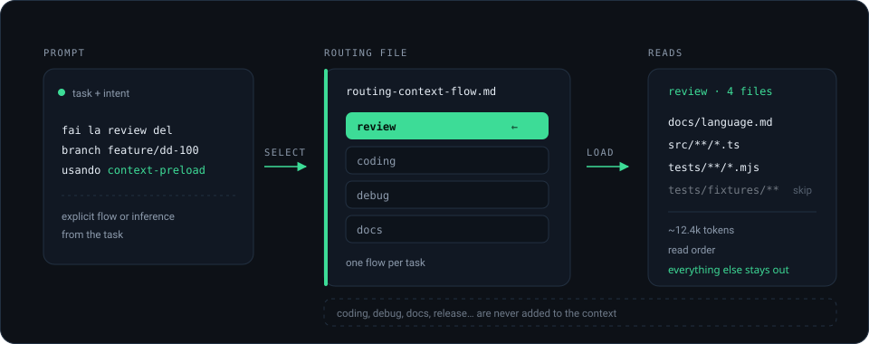

<div align="center">

# context-preload

**Tell the agent what to read, not the whole repository.**

[](https://github.com/BruceGitHub/context-preload-skill/actions/workflows/ci.yml)
[](LICENSE)
[](package.json)
[](package.json)

A skill + a tiny CLI + a visual editor for **routing the context** of an AI agent.

</div>

---

## The problem

Your repository has a large knowledge base: source, tests, docs, ADRs,
schemas, fixtures, examples. On every task the agent reads too much — or the
wrong things — and the context window fills with material that does not matter
for the job at hand.

`context-preload` adds one file to the repo: [`routing-context-flow.md`](routing-context-flow.md).
It declares **flows**. Each flow says which files to read for a kind of task,
what to skip and in which order.

```markdown
## Flow: review

- description: Review a change without rewriting it.
- read:
  - `docs/language.md`        | the contract to check against
  - `src/**/*.ts`             | the implementation
  - `tests/**/*.test.mjs`     | existing expectations
- skip:
  - `tests/fixtures/**`
```

Then the prompt stays natural:

> review the `feature/dd-100` branch using **context-preload**

The skill selects the `review` flow, reads only those files, and performs the
review normally. Other flows (`coding`, `debug`, `docs`…) are not loaded.

<div align="center">
  
</div>

## Quick start

```bash
git clone https://github.com/BruceGitHub/context-preload-skill.git
cd context-preload-skill
npm link                 # optional: puts `context-preload` on your PATH
```

In the repository you want to route:

```bash
context-preload init              # creates a starter routing-context-flow.md
context-preload list              # shows the flows
context-preload validate          # checks structure and paths
context-preload build             # writes routing-context-flow.build.md
```

No runtime dependencies, no build step for the CLI. Node.js >= 22.18 (native
TypeScript type stripping).

This repository ships its own [`routing-context-flow.md`](routing-context-flow.md)
and the generated [`routing-context-flow.build.md`](routing-context-flow.build.md),
so right after cloning you can run `context-preload list` and see the router
applied to itself.

## What the build file looks like

`context-preload build` merges the includes and writes one linear block per
flow:

```markdown
# Built routing — my-project
# Generated from routing-context-flow.md. Do not edit.

## review
Review a change without rewriting it.

Read these paths, in order:

1. `docs/language.md`
2. `src/core/**/*.ts`
3. `src/api/**/*.ts`
4. `tests/**/*.test.mjs`

Do not read:

- `tests/fixtures/**`
- `node_modules/**`

## coding
Implement a feature or a fix.

Read these paths, in order:

1. `docs/language.md`
2. `src/core/**/*.ts`
3. `src/**/*.ts`
```

The skill reads this file, picks the flow and follows the order. It never reads
the master. If the build is missing, the skill stops and asks you to run
`context-preload build`.

## Choosing a flow

| Situation | Behaviour |
| --- | --- |
| `use context-preload, flow review` | The named flow is used. |
| `review the feature/dd-100 branch using context-preload` | The flow is inferred from description keywords and id. |
| Ambiguous or no match | The agent asks, with a numbered list. Never a silent guess. |


## Multiple routing files

The build takes the file as input, so you can keep one master per team, service
or context:

```
routing-context-flow.md
.context/routing-context-flow.md
docs/routing-context-flow.backend.md
```

```bash
context-preload validate --file docs/routing-context-flow.backend.md
context-preload build --file docs/routing-context-flow.backend.md
# → docs/routing-context-flow.backend.build.md
```

Boring on purpose: no global state, no cache, no daemon. One file, read every
time.

## Visual editor

`editor/index.html` is a single, offline page: forms for global paths and
flows, a free-text mode for prose routing files, live canonical Markdown
preview, structural validation, import by file or drag & drop, download, copy,
a **Build** button that downloads `<name>.build.md`, and a local autosave draft.

```bash
context-preload editor                               # serves the blank editor
context-preload editor path/to/routing.md            # serves it with the file loaded
context-preload editor --port 8765                   # fixed port
```

Opening a file creates a temporary HTML copy with the content embedded, because
a browser cannot read local paths directly. `editor` starts a tiny local HTTP
server, prints an address such as `http://127.0.0.1:8765/` and keeps running
until Ctrl+C; it also launches the browser when stdout is an interactive
terminal. This is the reliable way to open the editor on
WSL, where `xdg-open` may not find a browser: when Chrome, Edge or Firefox is
installed on Windows, the CLI launches it directly with the URL. No CDN, no runtime dependencies: the server uses only
Node's built-in `http` module. It shares the parser with the CLI, so what you
see is what `validate` sees. See [docs/editor.md](docs/editor.md).

## Install as a skill

The repository root is a universal `SKILL.md` skill.

**OpenCode**

```bash
mkdir -p ~/.config/opencode/skills
ln -s "$PWD" ~/.config/opencode/skills/context-preload
```

Project-level: `.opencode/skills/context-preload`.

**Claude Code**

```bash
mkdir -p ~/.claude/skills
ln -s "$PWD" ~/.claude/skills/context-preload
```

Project-level: `.claude/skills/context-preload`.

The skill uses the CLI when it is on `PATH`, otherwise
`node <skill-dir>/bin/context-preload.ts`. It reads
`routing-context-flow.build.md`; run `context-preload build` after editing the
master.

## CLI

| Command | What it does |
| --- | --- |
| `context-preload list [file]` | List flows and includes. |
| `context-preload validate [file]` | Check syntax, ids, includes, cycles and paths. |
| `context-preload build [file]` | Write `<name>.build.md` with includes merged. |
| `context-preload init [file]` | Write a starter routing file. |
| `context-preload editor [file]` | Serve the visual editor, optionally with a routing file. |

Useful flags: `--file`, `--root`, `--strict`.

## The routing language

In the structured mode, a flow is a Markdown section with list keys:

| Key | Purpose |
| --- | --- |
| `description` | What the flow is for. |
| `includes` | Merge another flow's context first. |
| `read` | Files to read, in order (`path | note`). |
| `skip` | Globs removed from this flow. |

`## Global` adds `ignore`, `read order` and `root`.
Globs support `*`, `**`, `?`, `{a,b}` and `[abc]`. English key synonyms are
accepted (`use when`, `files`, `exclude`).

Full specification: [docs/language.md](docs/language.md).

### Free-text drafts

The editor's **Raw** mode can hold plain prose:

```markdown
When I am doing a review, read these files:
- `docs/language.md`
- `src/**/*.ts`
- `tests/**/*.test.mjs`

Skip `tests/fixtures/**`.
```

Free text is a scratch draft. `context-preload build` and the skill require
structured `## Flow:` sections; without them the build contains `_No flows._`.
See [examples/free-text-routing-context-flow.md](examples/free-text-routing-context-flow.md).

## Repository layout

```
.
├── SKILL.md                      # the agent-facing skill
├── bin/context-preload.ts        # CLI entry point
├── src/
│   ├── crf-core.ts               # parser, serializer, validator, ranking
│   ├── glob.ts                   # dependency-free glob matcher
│   ├── resolve.ts                # includes, skip/ignore, token estimates
│   ├── cli.ts                    # commands and output
│   ├── template.ts               # starter file written by `init`
│   └── types.ts                  # shared model types
├── editor/
│   ├── template.html             # layout + styles (source)
│   ├── editor.js                 # UI logic (source)
│   └── index.html                # generated, offline, committed
├── scripts/build-editor.mjs      # inlines the core into the editor
├── routing-context-flow.md       # this repository routes itself
├── examples/                     # structured and free-text routing examples
├── docs/                         # language, editor, diagram
└── tests/                        # node:test, fixtures, CLI smoke tests
```

## Development

```bash
npm install              # dev dependencies: TypeScript and @types/node
npm run typecheck        # tsc --noEmit
npm test                 # unit + resolver + CLI tests
npm run build:routing    # regenerate routing-context-flow.build.md
npm run build:editor     # regenerate editor/index.html
npm run validate:examples
npm run check            # all of the above
```

The CLI and the core are TypeScript, executed directly by Node's type stripping
(no emit step). `tsc` is only used for type checking. Zero runtime dependencies:
the core has no Node APIs, which is why the same code runs in the CLI and in
the browser. CI runs the tests on Node 22 and 24 and fails if
`editor/index.html` is stale.

## License

[MIT](LICENSE) © 2026 BruceGitHub
